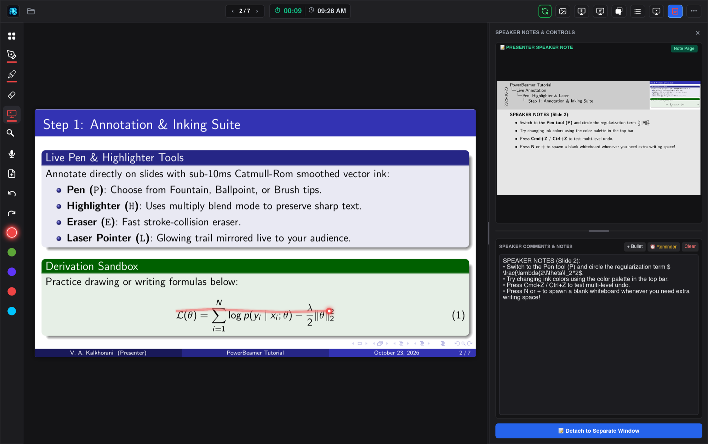
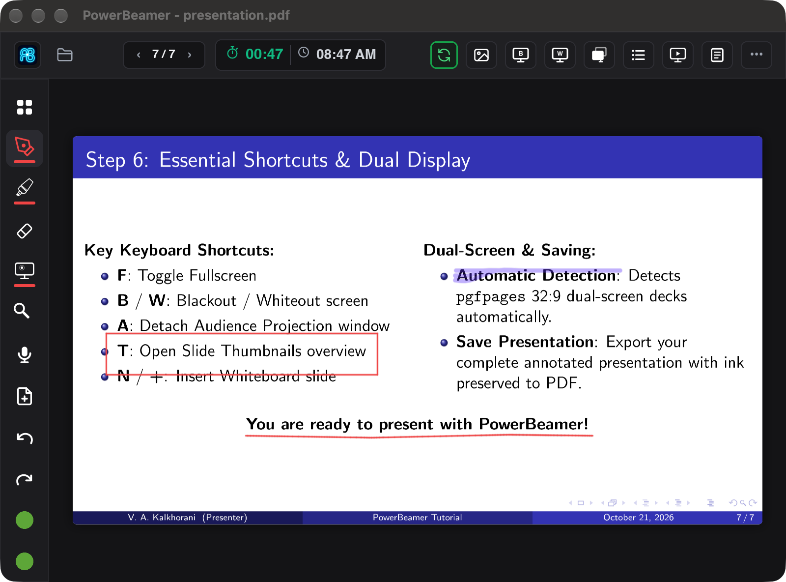
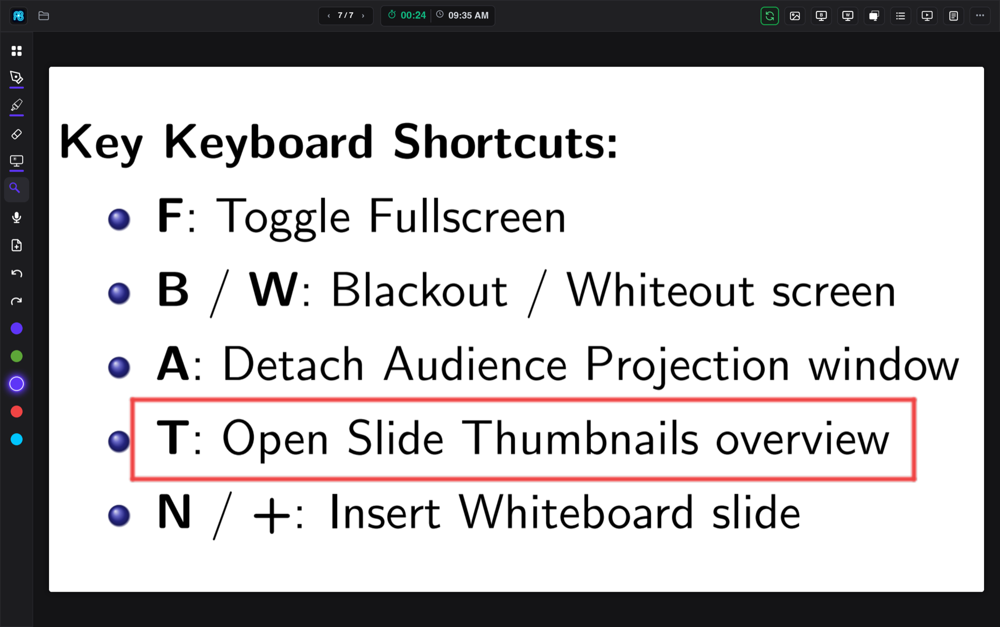
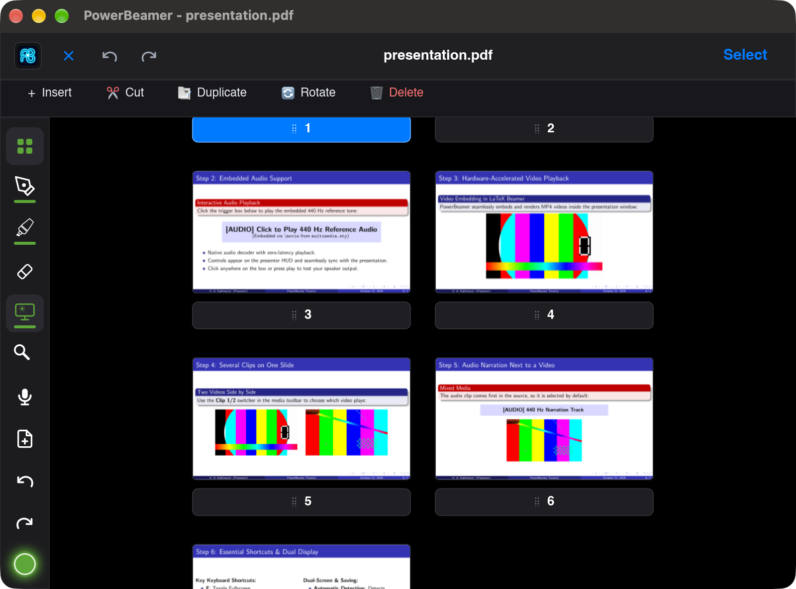
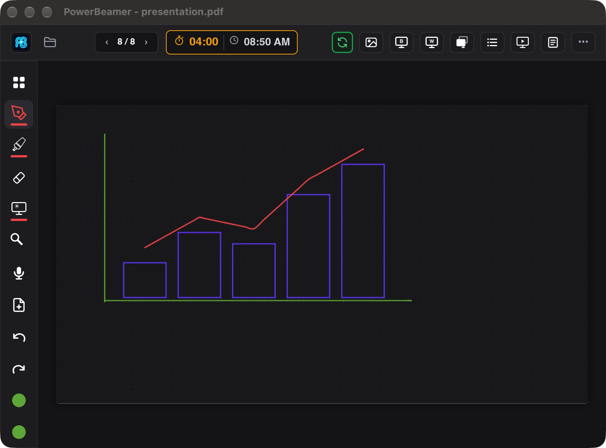
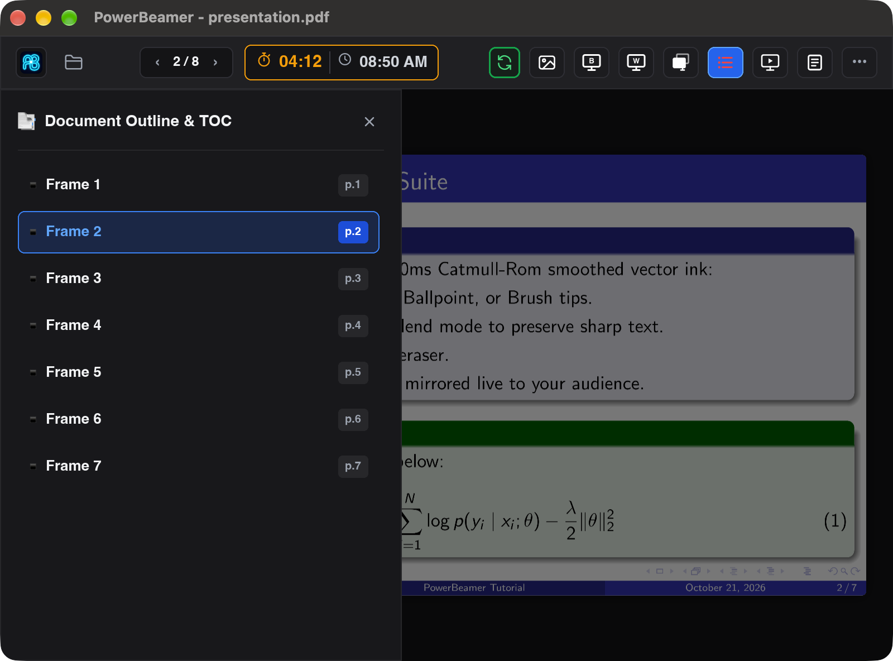
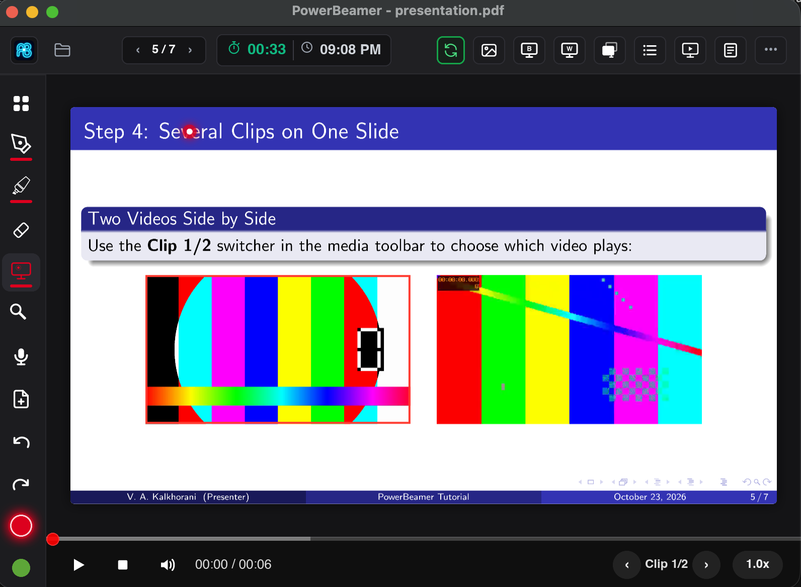

<p align="center">
  
</p>

<h1 align="center">PowerBeamer</h1>

<p align="center"><strong>The fast, ink-first presenter for LaTeX Beamer PDFs and PowerPoint presentations.</strong></p>

<p align="center">

[](https://github.com/ahmadikalkhorani/PowerBeamer/actions/workflows/release.yml) [](https://github.com/ahmadikalkhorani/PowerBeamer/releases) [](LICENSE)

</p>

A high-performance, low-footprint desktop presentation studio purpose-built for **LaTeX Beamer PDFs** and **PowerPoint presentations (`.pptx`, `.ppt`, `.odp`)**. Engineered in **Rust** with **Slint / WGPU** and **Google PDFium** for instant sub-millisecond slide transitions, fluid vector inking, native Beamer dual-screen auto-detection, speaker notes extraction, embedded audio/video playback, and modular multi-window docking.

---

## 📥 Download & Installation

Pre-compiled standalone packages are available under **[GitHub Releases](https://github.com/ahmadikalkhorani/PowerBeamer/releases/latest)**:

- 🍏 **macOS (Apple Silicon M1/M2/M3/M4)**: Download `PowerBeamer-macos-arm64.zip`, extract it, and drag `PowerBeamer.app` into your `/Applications` folder.
- 💻 **macOS (Intel x86_64)**: Download `PowerBeamer-macos-x86_64.tar.gz`.
- 🪟 **Windows (x86_64 / 64-bit)**: Download `PowerBeamer-windows-x86_64.zip`, extract the folder, and double-click `powerbeamer.exe` (bundles `pdfium.dll`, standalone portable).
- 🐧 **Linux (x86_64)**: Download `PowerBeamer-linux-x86_64.tar.gz`, extract the archive, and run `./powerbeamer`.

> **Tip:** PowerBeamer includes an automatic in-app updater. Once installed, future updates can be installed with a single click from the Options menu (`•••`).

### 🍏 macOS First-Launch Note (Gatekeeper / "App is damaged")

Because PowerBeamer is an independent open-source release, macOS Gatekeeper attaches a quarantine flag to internet-downloaded apps, often displaying:
> *"PowerBeamer is damaged and can't be opened. You should move it to the Trash."*

To open the app, run this single command in your **Terminal**:
```bash
xattr -d com.apple.quarantine /Applications/PowerBeamer.app
```
*(Or if the app is still in your Downloads folder: `xattr -d com.apple.quarantine ~/Downloads/PowerBeamer.app`)*

> **Why does this happen?**
> On **macOS Sequoia (15+)**, Apple removed the *"Open Anyway"* bypass button in System Settings for web-downloaded open-source apps. Running the `xattr -d com.apple.quarantine` command removes the browser download flag and permits macOS to launch PowerBeamer immediately.

---

## 📸 Screenshots

<p align="center">
  
  <br><em>Presenter view: speaker notes panel, countdown timer and the glowing laser trail</em>
</p>

<table>
  <tr>
    <td width="50%"><br><em>Vector ink, highlighter and auto-shape snapping</em></td>
    <td width="50%"><br><em>Drag-to-zoom into dense equations and plots</em></td>
  </tr>
  <tr>
    <td width="50%"><br><em>Thumbnail overview (<code>T</code>) with insert, cut, duplicate, rotate and delete</em></td>
    <td width="50%"><br><em>Insert a blank whiteboard mid-talk (<code>N</code>)</em></td>
  </tr>
  <tr>
    <td width="50%"><br><em>Outline / TOC drawer (<code>O</code>) for instant jumps</em></td>
    <td width="50%"><br><em>Built-in Audio/Video player (<code>M</code>)</em></td>
  </tr>
</table>

---

## 🏆 Why PowerBeamer?

Most PDF presenters treat a Beamer deck as a pile of pages. PowerBeamer understands Beamer, and adds the live-teaching tools you'd otherwise need a second app for.

| Feature | PowerBeamer | pdfpc | Pympress | BeamerPresenter | Keynote / PowerPoint (PDF) |
| :--- | :---: | :---: | :---: | :---: | :---: |
| Native `pgfpages` notes split (auto-detected) | ✅ | ✅ | ✅ | ✅ | ❌ |
| Overlay-aware frame navigation (skip `\pause` steps) | ✅ | ✅ | ❌ | ✅ | ❌ |
| Pressure-sensitive vector pen + highlighter | ✅ | ⚠️ basic | ⚠️ basic | ✅ | ⚠️ |
| **Auto-shape recognition** (lines, arrows, rectangles, diamonds) | ✅ | ❌ | ❌ | ❌ | ❌ |
| **Multiply-blend highlighter** (LaTeX text stays crisp) | ✅ | ❌ | ❌ | ⚠️ | ❌ |
| **Laser trail mirrored live to the audience** | ✅ | ❌ | ⚠️ | ✅ | ⚠️ |
| **Drag-to-zoom & pan** on any region | ✅ | ❌ | ✅ | ⚠️ | ❌ |
| **Insert whiteboard / grid slides on the fly** | ✅ | ❌ | ❌ | ⚠️ | ❌ |
| Embedded video/audio (`\movie`, `\includemedia`) | ✅ | ✅ | ✅ | ✅ | ❌ |
| **Export annotated PDF + reusable ink session** | ✅ | ❌ | ❌ | ✅ | ❌ |
| **Detachable floating notes window** | ✅ | ❌ | ❌ | ⚠️ | ❌ |
| One-click in-app updater | ✅ | ❌ | ❌ | ❌ | ✅ |
| macOS, Windows & Linux binaries | ✅ | ⚠️ | ✅ | ⚠️ | ⚠️ |
| Native GPU rendering, no Electron | ✅ | ✅ | ❌ (Python/GTK) | ✅ | ✅ |

<sub>✅ supported · ⚠️ partial or platform-limited · ❌ not available. Based on each project's default release at the time of writing; corrections welcome.</sub>

---

## ✨ Features

### 🔍 Built for LaTeX Beamer
- **Automatic dual-screen detection**: recognizes `pgfpages` side-by-side output (aspect ratio ≥ 2.0, e.g. 8:3 or 32:9) and splits audience slide from presenter notes. No flags or config.
- **Frame vs. overlay navigation**: `J` / `K` jump whole Beamer frames, while arrow keys step through every `\pause` and `\only` overlay.
- **Audience window options**: right-click the Audience Window button to hide the title bar for window sharing, keep the window on top, or enter full screen. Title-bar and on-top preferences are saved. Use Ctrl/⌘+Shift+B to restore the title bar for moving/resizing, or Escape in the audience window to exit full screen.
- **Outline / TOC drawer (`O`)** built from the PDF outline, plus a **thumbnail grid (`T`)** where you can also insert, cut, duplicate, rotate and delete pages.
- **Hold-to-follow hyperlinks**: press and hold an internal PDF link (~0.4 s, with a progress ring) to follow it, so you never jump by accident while inking.
- **Speaker notes and comments** in a resizable panel, or in a detached window.
- **Multimedia**: `\movie` and `\includemedia` video and audio play inline (`M` to toggle).

### 📊 PowerPoint & OpenDocument (`.pptx`, `.ppt`, `.odp`)
- **Direct file opening**: open `.pptx` decks directly via File Dialog or CLI (`powerbeamer presentation.pptx`).
- **Cross-platform headless engine**: natively converts slides using Microsoft PowerPoint (macOS AppleScript / Windows COM) or headless LibreOffice (`soffice`), with zero permission popups or manual steps.
- **OpenXML extraction**: reads speaker notes, slide titles, named sections for the TOC, and embedded media using the presentation's slide order and relationships.
- **Hidden PPTX slides**: skipped by next/previous and frame navigation, with a “Hidden” badge in the overview. Direct TOC, thumbnail, and slide-link jumps can still open them. Generated PDF conversions include every slide; companion PDFs must also include hidden slides.
- **PPTX hyperlinks and action buttons**: web/email links, direct slide jumps, next/previous/first/last slide, and end-show actions work through the existing click/hold link controls. Group transforms are applied to button hit areas. Precise text-link areas use links retained in the converted PDF; ambiguous text boxes with several different links require those PDF link areas. Macro, program-launch, custom-show, and last-viewed-slide actions are not supported.
- **Embedded Audio & Video**: extracts embedded audio/video clips (`.mp3`, `.wav`, `.m4a`, `.mp4`, `.mov`, etc.), preserving exact slide positions and bounding boxes.
- **Click-to-play media selection**: click directly on any audio icon or video bounding box on the presenter slide to switch and control playback.
- **Fast local caching**: saves conversion artifacts in `.cache/powerbeamer/` right in your presentation directory so future openings are instant (< 50 ms).

### 🎨 Live Annotation
- **✍️ Pen (`P`)**: pressure-sensitive vector ink with Catmull-Rom smoothing and under 10 ms latency.
- **📐 Auto-shapes**: draw and hold to snap rough strokes into clean lines, arrows, rectangles and diamonds.
- **🖍️ Highlighter (`H`)**: multiply blending keeps black LaTeX glyphs sharp beneath the color.
- **▱ Eraser (`E`)** with stroke-accurate hit testing.
- **⚡ Laser (`L`)** with a decaying glow trail shown on the audience screen.
- **🎨 5 color slots** (`1`–`5`) with a full color wheel.
- **⊕ Whiteboards (`N` / `+`)**: insert a blank or dotted-grid page anywhere.
- **🔎 Area zoom (`Z`)**: drag a box to magnify a figure and pan around; it resets on the next slide.
- **↶ Unlimited undo / redo.**

### 🖥️ Presenting
- **Presenter view**: current slide, next slide, notes, clock and timer.
- **Audience view**: clean output on the projector with strokes and laser synced live.
- **Blackout (`B`) / whiteout (`W`)** and **swap screens (`S`)**.
- **Configurable timer**: countdown or elapsed, warning threshold, overtime flash, and optional start on first advance.

### 💾 Save & Share
- Export annotated slides to **PDF** at Eco (150 DPI), Balanced (300 DPI) or Ultra (600 DPI).
- Non-destructive **`.presnotes.json`** sidecar keeps your ink and reloads it next time.

### 🚀 Lightweight
- Native Rust + Slint/WGPU + PDFium: a single small binary that idles under 50 MB RAM.

---

## ⌨️ Keyboard Shortcuts

| Shortcut | Action |
| :--- | :--- |
| `Space` / `→` / `↓` / `PgDn` / `Enter` | Next slide / overlay step |
| `←` / `↑` / `PgUp` / `Backspace` | Previous slide / overlay step |
| `J` / `K` | Next / previous Beamer frame (skip overlays) |
| `P` / `H` / `E` / `L` | Pen / Highlighter / Eraser / Laser |
| `Z` | Zoom tool (drag a box) / reset zoom |
| `1`–`5` | Select color slot |
| `N` or `+` | Insert whiteboard slide |
| `Tab` / `T` | Thumbnail overview |
| `O` | Table-of-contents drawer |
| `M` | Play / pause media |
| `B` / `W` | Blackout / whiteout audience screen |
| `S` | Swap presenter and audience screens |
| `Cmd/Ctrl + Z` | Undo |
| `Cmd/Ctrl + Shift + Z` / `Cmd/Ctrl + Y` | Redo |
| `Esc` | Close the active drawer/menu, stop media, or leave end-of-show |

---

## 🛠️ Building from Source

### Prerequisites
- [Rust & Cargo](https://rustup.rs/) (edition 2024 / 1.85+)
- CMake (used by Slint build dependencies)

### Run in Development
```bash
# Run with interactive LaTeX Beamer demo deck
cargo run

# Run with your own LaTeX Beamer PDF
cargo run -- /path/to/my_presentation.pdf

# Run with a PowerPoint presentation (.pptx)
cargo run -- /path/to/my_presentation.pptx
```

### Build Optimized Release Binary & macOS App
```bash
# Build release binary
cargo build --release

# Build standalone macOS application bundle (PowerBeamer.app)
./scripts/build_macos_app.sh
```

---

## Performance measurements

See the [performance report](docs/performance/README.md) for measured memory and speed changes, quality checks, tradeoffs, and reproduction commands.

---

## 🙏 Acknowledgments & Built With

PowerBeamer is built on the shoulders of fantastic open-source projects:

- **[Slint](https://slint.dev/)**: The next-generation declarative GUI toolkit and rendering engine powering the ultra-fluid, multi-window presentation interface.
- **[Google PDFium](https://pdfium.googlesource.com/pdfium/)** & **[pdfium-render](https://github.com/ajrcore/pdfium-render)**: Fast, rock-solid vector PDF rasterization and outline parsing.
- **[The Rust Community](https://www.rust-lang.org/)**: For foundational crates including `image`, `serde`, `chrono`, `rfd`, `ureq`, `flate2`, and `tar`.
- **[LaTeX Beamer](https://github.com/josephwright/beamer)**: Standardizing academic slide formats and `pgfpages` dual-screen presentations.

---

## 📄 License

PowerBeamer is released under the [MIT License](LICENSE). Third-party libraries retain their respective copyrights and licenses.
